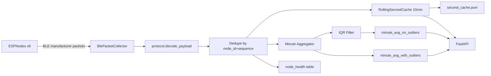

# SmartShelf Raspberry Pi Backend

Backend service for collecting BLE packets from SmartShelf ESP nodes, exposing live API data, and persisting minute-level aggregates.

## What This Service Does

- Scans BLE manufacturer advertisements from ESP modules.
- Decodes sensor payloads from SHT/VCNL/SGP sensors.
- Decodes mixed fleets, including protocol v5 autonomous VOC packets.
- Deduplicates repeated advertisements by `(node_id, sequence)`.
- Keeps a rolling 10-minute per-second cache in memory and on disk.
- Stores per-minute averages in SQLite:
  - with outliers
  - with outliers filtered (IQR-based)
- Exposes HTTP endpoints for dashboard integration.

## Architecture



## Module Layout

- `main.py` - service entrypoint and FastAPI startup/shutdown lifecycle.
- `api.py` - HTTP routes.
- `service.py` - orchestration: ingest, dedupe, cache, minute aggregation, DB writes.
- `collector.py` - BLE scanner callback integration (`BleakScanner`).
- `protocol.py` - payload decoding and packet/node dataclasses.
- `cache.py` - rolling second cache + atomic file persistence.
- `storage.py` - SQLite schema initialization and queries/upserts.
- `models.py` - Pydantic response models.
- `monitor_esp_ble.py` - optional terminal monitor for debugging.

## Prerequisites

- Python 3.10+ recommended
- Bluetooth available on Raspberry Pi host
- Dependencies from project root `requirements.txt`

Install dependencies from repository root:

```bash
pip install -r requirements.txt
```

## Run Instructions

### Start Backend API + BLE Ingestion

From repository root:

```bash
python -m RaspberryPi.backend.main
```

Optional arguments:

```bash
python -m RaspberryPi.backend.main \
  --host 0.0.0.0 \
  --port 8000 \
  --company-id 0xFFFF \
  --expected-nodes 9 \
  --stale-seconds 4.0 \
  --db-path RaspberryPi/data/smartshelf.db \
  --cache-path RaspberryPi/data/second_cache.json \
  --live-reload
```

`--live-reload` is enabled by default. Disable it with `--no-live-reload`.

### Optional Debug Monitor (Terminal UI)

This is not required for backend operation:

```bash
python -m RaspberryPi.backend.monitor_esp_ble
```

## API Endpoints

- `GET /health` - backend/scanner/database status.
- `GET /nodes/latest` - latest reading per node from rolling cache.
- `GET /nodes/realtime?window_seconds=600` - cached per-second readings.
- `GET /nodes/realtime/stream?window_seconds=600` - SSE stream of rolling-window cache snapshots (1s cadence).
- `GET /nodes/status` - online/stale and packet/drop counters per node.
- `GET /nodes/minute-history?outliers=include|exclude&from_ts=&to_ts=&node_id=` - minute aggregates from SQLite.
- `GET /api/categories` - predefined food-category trigger presets and metric limits.
- `GET|POST /api/product-profiles` - list or create persisted product profiles.
- `GET|PUT|DELETE /api/product-profiles/<profile_id>` - read, update, or safely delete a profile. Delete returns `409` while linked/override cells reference it.
- `GET /api/cells/config` - current trigger bounds/category assignment for every cell.
- `PUT /api/cells/<node_id>/config` - assign `linked`, `override`, or `custom` settings. Profile modes use `profile_id`; override also accepts a partial `voc_policy_override`. Legacy category/custom requests remain supported.
- `GET /api/voc-alerts` - durable autonomous VOC alert-latch state.

## Trigger System & Email Alerts

Each cell's temperature/humidity/VOC readings are classified into green/yellow/red
zones using either a predefined food category (`config/categories.json`, read-only)
or manually-set custom bounds. Bounds and category assignments are persisted per
cell in the SQLite `cell_config` table (same DB as minute averages). On first
startup with an empty table, values are seeded once from `config/config.json`
when present; after that, API / Live Tiles changes update the existing DB only.

When a metric stays in a worse zone (green->yellow or yellow->red) continuously for
more than `TRIGGER_SUSTAIN_SECONDS` (default 120s, see `config/constants.py`), an
email alert is sent once for that transition. Evaluation is skipped for empty
cells (no product placed) and resets if a sensor's readings go stale.

### Configuring email alerts (SMTP)

Easiest path with Gmail:

1. Enable 2-Step Verification on the Google account.
2. Create an [App Password](https://myaccount.google.com/apppasswords) (16 characters).
3. Copy `config/email_config.example.json` to `config/email_config.json` (gitignored)
   and fill in:
   - `username` / `password` — Gmail address + app password
   - `from_address` — usually the same Gmail address
   - `recipients` — one or more email addresses to notify
4. Defaults (`smtp.gmail.com`, port `587`, `use_tls: true`) work for Gmail.
   Other providers: set `smtp_host` / `smtp_port` accordingly.

Or set environment variables instead (they take precedence over the file):
`EMAIL_SMTP_HOST`, `EMAIL_SMTP_PORT`, `EMAIL_USE_TLS`, `EMAIL_USERNAME`,
`EMAIL_PASSWORD`, `EMAIL_FROM`, `EMAIL_FROM_NAME`, `EMAIL_RECIPIENTS`
(comma-separated list).

Until SMTP credentials and at least one recipient are configured, the backend
logs a one-time warning and skips sending alerts — everything else keeps working
normally.

## Autonomous VOC monitoring (protocol v5/v6)

Protocol v5 uses the 16-byte layout below. Protocol v6 keeps that prefix and
appends phase countdown fields (21-byte payload). Both report VOC change score,
ESP lifecycle state, baseline/environment quality, and 6/10-sigma evidence.
Score `255` is unavailable. Only monitoring-state (`5`) readings with a valid
baseline and no environment fault are usable for policy timing.

The packed little-endian manufacturer layout is:

```text
Manufacturer offset  Size  Field
0                    2     Company ID (0xFFFF; outside the payload)
2                    1     Protocol version (5 or 6)
3                    2     Node ID
5                    1     Flags
6                    2     Temperature x100 (signed; INT16_MIN unavailable)
8                    2     Relative humidity x100
10                   2     VCNL4040 proximity
12                   2     VOC Index (signed; -1 unavailable)
14                   1     VOC change score (0..100; 255 unavailable)
15                   1     ESP lifecycle state
16                   2     Packet sequence
18                   2     Phase remaining seconds (v6)
20                   1     Concurrent state (v6; 1=stabilize while settling)
21                   2     Concurrent remaining seconds (v6)
```

v5 advertisements are 18 bytes with company ID; v6 is 23 bytes. Flag bits are:
bit 0 SHT valid, bit 1 proximity valid, bit 2 SGP41 valid, bit 3 frozen
baseline valid, bit 4 environment fault, bit 5 6-sigma evidence, bit 6
10-sigma evidence, and bit 7 reserved.

Firmware defaults are 10 seconds conditioning, 5 minutes stabilization,
30 seconds insertion confirmation, 60 seconds removal confirmation, 5 minutes
headspace settling (may run concurrently with stabilization when a product is
inserted during warm-up; proximity full/empty matches the dashboard at
prox > 20 = full, prox ≤ 20 = empty),
15 one-minute baseline medians, 90% RH fault entry,
87% RH recovery for five continuous minutes, and a 25-tick minimum noise floor.
`VOC_TICKS_PER_DOUBLING=870` is only the SGP41 datasheet's typical ethanol
response under controlled conditions. It creates a dimensionless relative
scale; neither SRAW_VOC nor the score is an absolute concentration or proof of
microbiological safety.

The Raspberry Pi owns the policy. The dashboard exposes only warning, alert,
and critical scores. Each severity uses a fixed 30-minute continuous duration,
fixed evidence gates (warning 6σ, alert/critical 10σ), and an internal warning
clear hysteresis (default clear score 20 for 5 minutes). Critical is always
enabled. Product profiles are persisted in SQLite. Linked cells follow profile
edits, override cells merge a partial score patch over a linked profile, and
custom cells remain independent.
Profiles store temperature and humidity zone bounds plus `voc_policy` only;
VOC Index zone bands are no longer part of product profiles.

```json
{
  "voc_policy": {
    "warning_score": 25,
    "warning_sigma": 6,
    "warning_seconds": 1800,
    "warning_clear_score": 20,
    "warning_clear_seconds": 300,
    "alert_score": 50,
    "alert_sigma": 10,
    "alert_seconds": 1800,
    "critical_score": 75,
    "critical_sigma": 10,
    "critical_seconds": 1800
  }
}
```

Warning state and alert/critical latches are stored in SQLite and survive stale
packets, environment faults, score drops, sequence restarts, and backend
restarts. Warning clears only through its score/duration hysteresis. Alert and
critical clear only on v5 ESP EMPTY (`2`). Unusable or missing evidence resets
pending timers without clearing durable state. Protocol v4 and older retain
their VOC Index zone trigger.
Communication remains one-way: ESP nodes advertise evidence and never require
BLE commands, Wi-Fi, cloud processing, or configuration returned by the Pi.

To send a test email after filling the config:

```bash
python RaspberryPi/backend/scripts/test_email.py
```

## Data Storage

Default paths:

- SQLite DB: `RaspberryPi/data/smartshelf.db`
- Cache snapshot: `RaspberryPi/data/second_cache.json`

SQLite tables:

- `minute_avg_with_outliers`
- `minute_avg_no_outliers`
- `node_health`
- `cell_config` (including `voc_policy_json`)
- `product_profiles`
- `voc_alert_state` (durable warning and alert/critical severity)

## Quick Testing

After backend starts, check:

- [http://localhost:8000/health](http://localhost:8000/health)
- [http://localhost:8000/nodes/latest](http://localhost:8000/nodes/latest)

If minute tables are empty, wait for the next minute boundary (minute aggregates are persisted after each minute closes).

