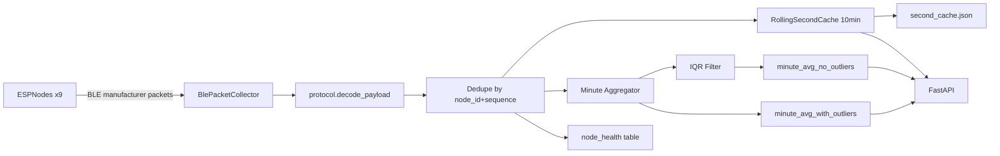

# SmartShelf Raspberry Pi Backend

Backend service for collecting BLE packets from SmartShelf ESP nodes, exposing live API data, and persisting minute-level aggregates.

## What This Service Does

- Scans BLE manufacturer advertisements from ESP modules.
- Decodes sensor payloads from SHT/VCNL/SGP sensors.
- Deduplicates repeated advertisements by `(node_id, sequence)`.
- Keeps a rolling 10-minute per-second cache in memory and on disk.
- Stores per-minute averages in SQLite:
  - with outliers
  - with outliers filtered (IQR-based)
- Exposes HTTP endpoints for dashboard integration.

## Architecture



## Module Layout

- `main.py` - service entrypoint and FastAPI startup/shutdown lifecycle.
- `api.py` - HTTP routes.
- `service.py` - orchestration: ingest, dedupe, cache, minute aggregation, DB writes.
- `collector.py` - BLE scanner callback integration (`BleakScanner`).
- `protocol.py` - payload decoding and packet/node dataclasses.
- `cache.py` - rolling second cache + atomic file persistence.
- `storage.py` - SQLite schema initialization and queries/upserts.
- `models.py` - Pydantic response models.
- `monitor_esp_ble.py` - optional terminal monitor for debugging.

## Prerequisites

- Python 3.10+ recommended
- Bluetooth available on Raspberry Pi host
- Dependencies from project root `requirements.txt`

Install dependencies from repository root:

```bash
pip install -r requirements.txt
```

## Run Instructions

### Start Backend API + BLE Ingestion

From repository root:

```bash
python -m RaspberryPi.backend.main
```

Optional arguments:

```bash
python -m RaspberryPi.backend.main \
  --host 0.0.0.0 \
  --port 8000 \
  --company-id 0xFFFF \
  --expected-nodes 9 \
  --stale-seconds 4.0 \
  --db-path RaspberryPi/data/smartshelf.db \
  --cache-path RaspberryPi/data/second_cache.json
```

### Optional Debug Monitor (Terminal UI)

This is not required for backend operation:

```bash
python -m RaspberryPi.backend.monitor_esp_ble
```

## API Endpoints

- `GET /health` - backend/scanner/database status.
- `GET /nodes/latest` - latest reading per node from rolling cache.
- `GET /nodes/realtime?window_seconds=600` - cached per-second readings.
- `GET /nodes/realtime/stream?window_seconds=600` - SSE stream of rolling-window cache snapshots (1s cadence).
- `GET /nodes/status` - online/stale and packet/drop counters per node.
- `GET /nodes/minute-history?outliers=include|exclude&from_ts=&to_ts=&node_id=` - minute aggregates from SQLite.

## Data Storage

Default paths:

- SQLite DB: `RaspberryPi/data/smartshelf.db`
- Cache snapshot: `RaspberryPi/data/second_cache.json`

SQLite tables:

- `minute_avg_with_outliers`
- `minute_avg_no_outliers`
- `node_health`

## Quick Testing

After backend starts, check:

- [http://localhost:8000/health](http://localhost:8000/health)
- [http://localhost:8000/nodes/latest](http://localhost:8000/nodes/latest)

If minute tables are empty, wait for the next minute boundary (minute aggregates are persisted after each minute closes).

